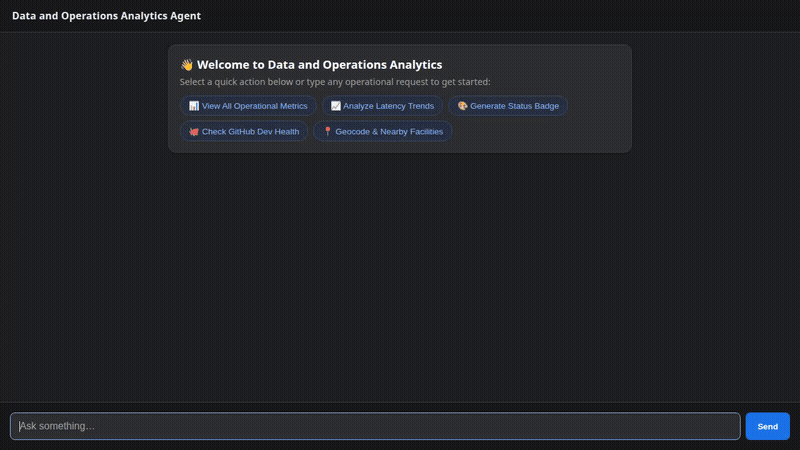

# Data and Operations Analytics Agent

An intelligent operational analytics, system telemetry, and location intelligence agent built with Google Agent Development Kit (ADK) and deployed to Google Cloud Agent Platform (Agent Runtime) using the A2A protocol.



---

## What the Agent Does

The agent connects real-time operational data, geospatial intelligence, code execution, and telemetry to help engineers and stakeholders monitor system health, detect anomalies, and personalize assistance:

1. **Firestore Operational Metrics Management**:
   - Reads, lists, filters, and records system performance metrics (`latency`, `error rates`, `cpu utilization`, `availability`, etc.) directly from Cloud Firestore collections.
2. **Statistical Trend & Anomaly Detection**:
   - Calculates moving averages, standard deviation intervals, variance, and flags threshold breaches or anomalies across time-series metrics.
3. **Public DevOps Health Telemetry**:
   - Fetches live GitHub repository metrics (stars, forks, open issues, commit backlogs) via public REST endpoints.
4. **Google Maps Geocoding & Places (New) API**:
   - Resolves physical data center and facility addresses into geographic coordinates (`latitude`/`longitude`).
   - Discovers nearby amenities and operational facilities given coordinates.
5. **Multimodal Visual Status Badges**:
   - Generates status badge imagery via the `gemini-3.1-flash-lite-image` model.
   - Saves artifacts to the agent context and publishes image assets to a Google Cloud Storage bucket.
6. **Agent Engine Python Sandbox**:
   - Safely executes Python code inside an isolated Vertex AI Agent Engine sandbox for statistical aggregations, percentiles, and computations.
7. **Cross-Session Long-Term Memory**:
   - Ingests session conversations into Vertex AI Memory Bank (`PreloadMemoryTool` and post-turn session ingestion callback) to remember user preferences, operational thresholds, and facts across conversations.
8. **Native A2UI Card Generation**:
   - Emits structured A2UI v0.8 cards, columns, rows, and status indicators rendered dynamically by the chat interface.

---

## Google Cloud Services Wired Up

- **Vertex AI Agent Platform (Agent Runtime)**: Hosts the deployed agent container running over the A2A (Agent-to-Agent) protocol.
- **Vertex AI Memory Bank**: Provides managed long-term, cross-session memory extraction and recall.
- **Cloud Firestore**: Persistent NoSQL database storing live operational metrics and historical readings.
- **Cloud Storage (GCS)**: Stores generated metric status badges and visual assets with public HTTP access.
- **Google GenAI / Vertex AI Imagen**: Generates visual badge assets with `gemini-3.1-flash-lite-image`.
- **Vertex AI Agent Engine Sandbox**: Isolated Python runtime execution environment.
- **Google Maps Platform (Geocoding & Places New)**: Resolves addresses and nearby points of interest.

---

## Project Structure

```
ops-analytics-agent/
├── app/
│   ├── agent.py               # Core ADK agent, tools, callbacks, and A2UI schema manager
│   ├── a2ui_utils.py          # A2UI response formatter callback
│   ├── fast_api_app.py        # FastAPI server backend & memory service initialization
│   └── app_utils/             # Memory Bank & telemetry service providers
├── frontend/
│   ├── main.py                # Minimal FastAPI A2A proxy talking to Agent Runtime
│   ├── requirements.txt       # Frontend proxy dependencies
│   └── static/
│       └── index.html         # Dark theme single-page chat UI with built-in A2UI renderer
├── docs/
│   └── assets/
│       └── demo.gif           # Looping animated demo
├── agents-cli-manifest.yaml   # Deployment and agent runtime configuration
├── deployment_metadata.json   # Deployed Agent Runtime resource tracking
└── pyproject.toml             # Project dependencies and packaging
```

---

## Setup & Local Run Instructions

### 1. Prerequisites

- Python 3.11+
- `uv` package manager (`pip install uv` or install via Astral docs)
- Google Cloud SDK (`gcloud`) authenticated with Application Default Credentials:
  ```bash
  gcloud auth application-default login
  gcloud config set project <YOUR_PROJECT_ID>
  ```

### 2. Environment Variables

Create a `.env` file in the project root:

```bash
GOOGLE_GENAI_USE_VERTEXAI=true
GOOGLE_CLOUD_PROJECT=<YOUR_PROJECT_ID>
GOOGLE_CLOUD_LOCATION=global
GOOGLE_MAPS_API_KEY=<YOUR_GOOGLE_MAPS_API_KEY>
```

### 3. Running the Agent Backend Locally

To run the agent locally with ADK's development playground and Vertex AI Memory Bank:

```bash
# Install agent dependencies
uv sync

# Launch local ADK dev UI with memory bank connection
uv run adk web . --port 8080 --reload_agents --memory_service_uri=agentengine://<YOUR_AGENT_ENGINE_ID>
```

### 4. Running the Frontend Proxy & Chat UI

To run the standalone Dark Theme Chat UI and FastAPI A2A proxy against a deployed Agent Runtime:

```bash
cd frontend

# Set up virtual environment and install dependencies
python3 -m venv .venv
source .venv/bin/activate
pip install -r requirements.txt

# Configure deployed agent targets (replace with your resource name)
export AGENT_ENGINE_RESOURCE_NAME="projects/<PROJECT_NUMBER>/locations/<REGION>/reasoningEngines/<ENGINE_ID>"
export AGENT_DIRECTORY="app"
export PORT=8080

# Start frontend server
python main.py
```

---

## Deployment to Agent Platform

Deploy or update the agent on Agent Platform using `agents-cli`:

```bash
agents-cli deploy \
  --project <YOUR_PROJECT_ID> \
  --region us-east1 \
  --update-env-vars GOOGLE_MAPS_API_KEY=<YOUR_GOOGLE_MAPS_API_KEY> \
  --no-confirm-project
```

